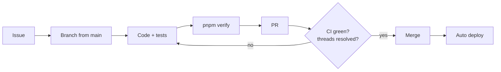

# Contributing to Software Empire

Thanks for stopping by. This repo is maintained by one person, so the faster a PR is to review, the faster it lands. This guide shows you how.

**Contents:** [Ways to help](#ways-to-help) · [Setup](#setup) · [Workflow](#workflow) · [House rules](#house-rules) · [Testing](#testing) · [Commits and PRs](#commits-and-prs) · [Troubleshooting](#troubleshooting)

## Ways to help

| You want to               | Do this                                                                    |
| ------------------------- | -------------------------------------------------------------------------- |
| Report a bug              | Open an issue with steps to reproduce, what you expected, and a screenshot |
| Suggest a feature         | Open an issue with the feature template before writing code                |
| Fix something small       | Send a PR straight away: typos, docs, one-file fixes                       |
| Report a security problem | **Do not open an issue.** Follow [SECURITY.md](SECURITY.md)                |

## Setup

You need **Node 24**, **pnpm 12** and **Docker**.

```sh
git clone https://github.com/CROC101/software-empire.git
cd software-empire
pnpm install
pnpm db:start && pnpm db:reset
```

Copy every app's `.env.example` to `.env.local`. The hub needs `APP_URL_<SLUG>` for each app you run, or links and post-login redirects break. Demo accounts are listed at the top of `supabase/seed.sql`.

Run one app with `pnpm --filter @empire/<app> dev`. Use `localhost`, not `127.0.0.1`: the session cookie is bound to the host name.

## Workflow



Branch names: `feature/<app>/<topic>`, `fix/<app>/<topic>`, `chore/<app>/<topic>`, `docs/<app>/<topic>`. ASCII only, no spaces.

## House rules

These are enforced in review. A PR that breaks one will not be merged.

1. **RLS on every table.** Policies use `auth.uid()`. Privacy rules (blocking, who sees what) live in RLS or SQL functions, never only in app code.
2. **No tokens in `localStorage`.** Sessions use `@supabase/ssr` cookies. Server code checks auth with `getClaims()`, never `getSession()`.
3. **Validate every boundary with Zod:** forms, API routes, Worker `postMessage`. Sanitize user HTML and Markdown with DOMPurify.
4. **Every redirect goes through** `safeNext` (hub) or `safeRedirectTarget` from `@empire/core/redirect`.
5. **Heavy work goes off the main thread:** parsing, images, audio, ML run in a Web Worker with Comlink (`validated` + `expose` from `@empire/core/worker`).
6. **Design tokens only.** Colors and spacing come from `packages/ui`. Create Supabase clients only through `@empire/core/supabase`.
7. **No secrets, no `.env` files, no new paid services** in a PR.
8. **Architecture changes need an ADR.** If you go against a decision in `docs/MASTER-SPEC.md`, update it in the same PR.

## Testing

| Change                                        | Test it with                                                                                            |
| --------------------------------------------- | ------------------------------------------------------------------------------------------------------- |
| New logic: branches, parsers, money, security | A unit test next to the code (Vitest)                                                                   |
| New table or policy                           | A pgTAP test in `supabase/tests`, run `pnpm db:test`                                                    |
| Changed migration                             | `pnpm db:reset`, then `pnpm db:types` and commit the types                                              |
| UI                                            | Check mobile (360 px) and desktop, keyboard and screen reader                                           |
| community realtime                            | `pnpm --filter @empire/community smoke` (and `smoke:chat`, `smoke:feed`, `smoke:notify`, `smoke:voice`) |

Before every push:

```sh
pnpm format:check && pnpm verify
```

## Commits and PRs

Use [Conventional Commits](https://www.conventionalcommits.org):

```
feat(hub): add season picker to the ambience menu
fix(toolboxes): keep JSON formatter output on tab switch
docs: explain local Supabase setup
```

In the PR:

- Fill in the template and link the issue (`Closes #123`).
- Add before/after screenshots for UI changes.
- Keep it to one app or package where you can. Small PRs merge first.

`main` is protected: a PR needs the `verify` check green and every review thread resolved. Merged branches are deleted automatically, and `main` deploys on merge.

## Troubleshooting

| Symptom                                        | Fix                                                             |
| ---------------------------------------------- | --------------------------------------------------------------- |
| PostgREST 503 on `db:start`                    | `supabase start --ignore-health-check`, then `pnpm db:reset`    |
| 406 from the API after editing `[api] schemas` | `pnpm db:stop && pnpm db:start` (`db:reset` does not reload it) |
| Logged in on the hub, logged out in an app     | You used `127.0.0.1`. Use `localhost`                           |
| Vitest workers time out in `pnpm verify`       | Keep `--concurrency=50%`, do not raise it                       |
| Type errors about `node` or `vite/client`      | TS 6 defaults to `types: []`; add them to your `tsconfig.json`  |

## License

By contributing, you agree that your work is released under the [MIT License](LICENSE).
