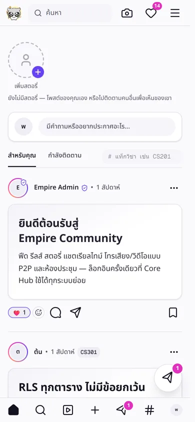
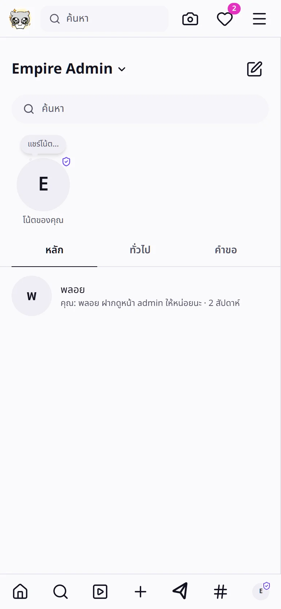
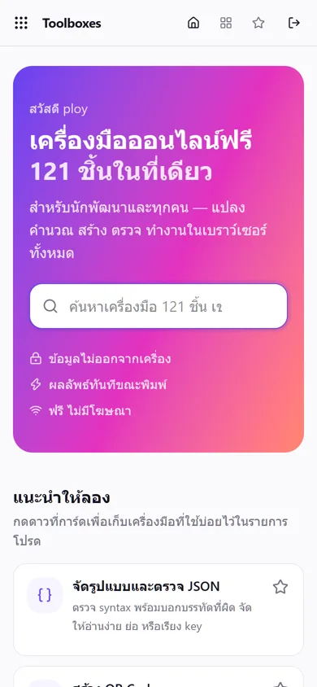
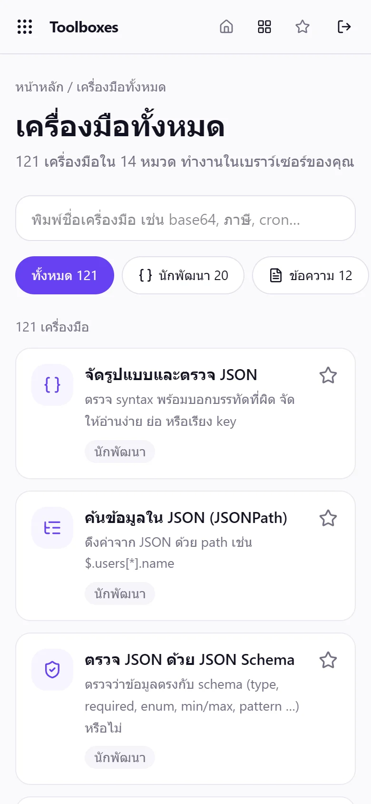
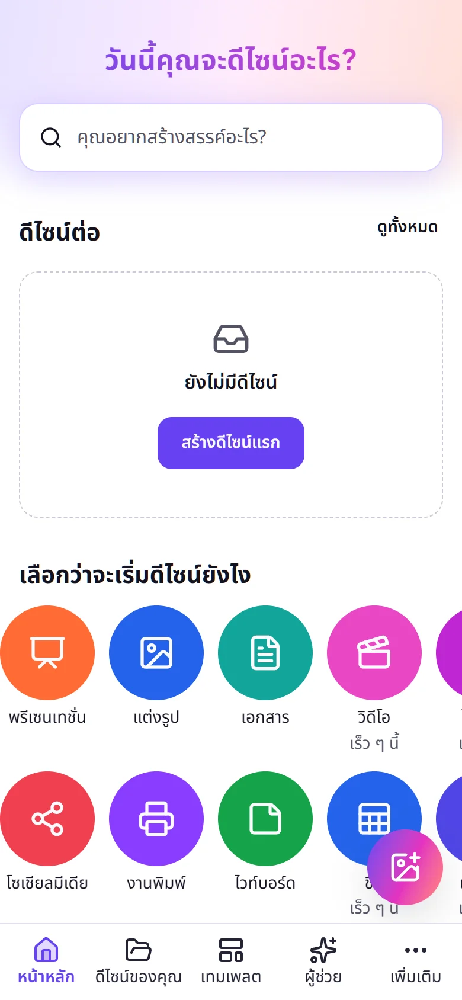
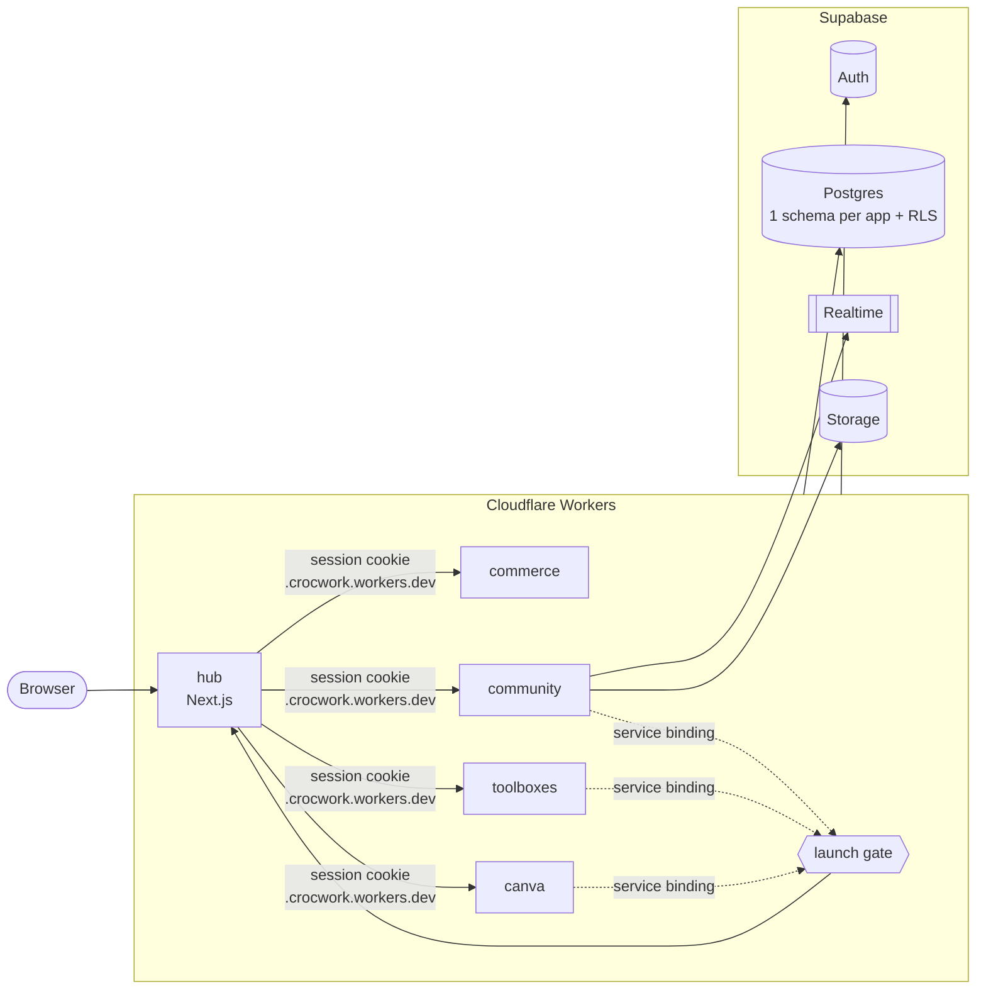

<p align="center">
  
</p>

<h1 align="center">Software Empire</h1>

<p align="center">
  <strong>One login. Six apps. Zero dollars a month.</strong><br>
  <sub>An enterprise-grade portfolio, built and run by one developer.</sub>
</p>

<p align="center">
  <a href="https://github.com/CROC101/software-empire/actions/workflows/ci.yml"></a>
  <a href="https://github.com/CROC101/software-empire/actions/workflows/deploy.yml"></a>
  <a href="https://github.com/CROC101/software-empire/actions/workflows/codeql.yml"></a>
  <a href="https://scorecard.dev/viewer/?uri=github.com/CROC101/software-empire"></a>
  <a href="LICENSE"></a>
</p>

<p align="center">
  
  
  
  
  
  
  
</p>

<p align="center">
  <a href="https://crocwork-hub.crocwork.workers.dev"><strong>Visit the live site &rarr;</strong></a>
</p>

<p align="center">
  <a href="https://crocwork-hub.crocwork.workers.dev"></a>
</p>

<p align="center">
  <a href="#apps">Apps</a> &middot;
  <a href="#numbers">Numbers</a> &middot;
  <a href="#architecture">Architecture</a> &middot;
  <a href="#security">Security</a> &middot;
  <a href="#quick-start">Quick start</a> &middot;
  <a href="CONTRIBUTING.md">Contributing</a>
</p>

---

Most portfolios are a page of screenshots. This one is the real thing: a hub with single sign-on, a CMS, and six working products behind it. A chat app with video meetings, a freelance market, 121 developer tools, a graphics editor. They share one design system, one session cookie and one CI pipeline, and the whole thing runs on free tiers.

## Apps

|     | App                             | What it does                                                     | Stack              |
| --- | ------------------------------- | ---------------------------------------------------------------- | ------------------ |
| 🌳  | [**hub**](apps/hub)             | Portfolio, single sign-on, `/admin` CMS that edits every app     | Next.js 16         |
| 💬  | [**community**](apps/community) | Realtime chat, feed, reels, stories, WebRTC meetings, moderation | Vite SPA           |
| 🛒  | [**commerce**](apps/commerce)   | Freelance market, buyers pay sellers straight to PromptPay       | Next.js 16         |
| 🧰  | [**toolboxes**](apps/toolboxes) | 121 browser tools, heavy work runs in Web Workers                | Vite SPA           |
| 🎨  | [**canva**](apps/canva)         | Canvas graphics editor with cloud saves                          | Vite SPA           |
| 🐊  | [**crocbyte**](apps/crocbyte)   | Client-work site                                                 | Next.js + Firebase |

<p align="center">
  
  
  
</p>

<p align="center">
  
  
  
  
  
</p>

## Numbers

|                    |                                                                                                |
| -----------------: | ---------------------------------------------------------------------------------------------- |
|             **$0** | monthly infrastructure cost (Cloudflare Workers + Supabase free tiers)                         |
|              **6** | live apps behind **1** login                                                                   |
|            **121** | developer tools in toolboxes                                                                   |
|            **268** | pgTAP tests guarding Row Level Security                                                        |
|             **14** | versioned database migrations, deployed by CI                                                  |
|             **10** | GitHub Actions workflows: CI, deploy, database, backup, CodeQL, Scorecard, keep-alive and more |
| **58% &rarr; 19%** | idle CPU on the hub after sections far from the screen go to sleep                             |

## Architecture



- **One schema per app.** `cms`, `community`, `commerce`, `toolboxes`, `canva` each own their tables. Privacy rules live in RLS and SQL functions, never only in app code.
- **One session.** Every app builds its Supabase client through `@empire/core/supabase`, so cookie options match and login carries across subdomains.
- **One design system.** [`packages/ui`](packages/ui): Tailwind v4 tokens and components. No raw colors or spacing in apps.
- **Main thread stays free.** Parsing, images, audio and ML run in Web Workers through Comlink, with Zod-validated messages.
- **Edit without deploying.** Each app declares its editable pages in code with defaults. The hub `/admin` writes them to `cms`; if the database is down, the defaults show.

Decisions and trade-offs are recorded as ADRs in [`docs/MASTER-SPEC.md`](docs/MASTER-SPEC.md).

## Security

- Row Level Security on every table, each policy tested with pgTAP
- Session in `@supabase/ssr` cookies, never `localStorage`; server checks JWT signatures with `getClaims()`
- Zod at every boundary: forms, APIs, Worker messages. User HTML goes through DOMPurify
- Every redirect target is checked (`safeNext`, `safeRedirectTarget`)
- CSP, HSTS (2 years), COOP, `X-Frame-Options: DENY`, `nosniff`, Permissions-Policy
- GitHub Actions pinned by SHA, least-privilege tokens, CodeQL, OpenSSF Scorecard, Dependabot, dependency review, secret scanning with push protection
- Nightly AES-256 encrypted database backups kept for 30 days

Found a hole? Please report it privately: [SECURITY.md](SECURITY.md).

## Quick start

Requires **Node 24**, **pnpm 12** and **Docker** (for local Supabase).

```sh
git clone https://github.com/CROC101/software-empire.git
cd software-empire
pnpm install
pnpm db:start && pnpm db:reset   # local Supabase with demo accounts
pnpm --filter @empire/hub dev    # http://localhost:3000
```

Copy each app's `.env.example` to `.env.local` first.

<details>
<summary><strong>All commands</strong></summary>

| Command                             | What it does                                     |
| ----------------------------------- | ------------------------------------------------ |
| `pnpm dev`                          | Every app at once                                |
| `pnpm verify`                       | Lint, typecheck, test, build: the same as CI     |
| `pnpm format` / `pnpm format:check` | Prettier                                         |
| `pnpm db:start` / `db:stop`         | Local Supabase in Docker                         |
| `pnpm db:reset`                     | Fresh database from migrations + seed            |
| `pnpm db:test`                      | pgTAP tests                                      |
| `pnpm db:types`                     | Regenerate `packages/core/src/database.types.ts` |
| `pnpm --filter <app> dev`           | One app (`@empire/hub`, `@empire/toolboxes`, …)  |

| App       | Local URL             |
| --------- | --------------------- |
| hub       | http://localhost:3000 |
| community | http://localhost:3001 |
| toolboxes | http://localhost:3003 |
| canva     | http://localhost:3006 |
| crocbyte  | http://localhost:3007 |

</details>

<details>
<summary><strong>Repository layout</strong></summary>

```
apps/
  hub/         portfolio, SSO, /admin CMS
  community/   chat, feed, reels, meetings
  commerce/    freelance market
  toolboxes/   121 tools
  canva/       graphics editor
  crocbyte/    client-work site (Firebase)
packages/
  ui/          design system
  core/        Supabase client, auth, CMS, theme, Worker helpers, Zod schemas
  config/      ESLint and tsconfig bases
supabase/
  migrations/  schema history
  tests/       pgTAP
standards/     repo rules
docs/          spec, ADRs, deploy guide
.github/       workflows, templates, CODEOWNERS, Dependabot
```

</details>

## Deploy

Push to `main` and CI does the rest: verify, build each app as a Worker, check bundle size, deploy, and push database migrations. Every PR gets its own preview. Setup from scratch: [`docs/DEPLOY.md`](docs/DEPLOY.md).

## Roadmap

- [x] Hub, SSO, CMS
- [x] community, commerce, toolboxes, canva on Cloudflare
- [x] Encrypted backups, CodeQL, Scorecard
- [ ] Public launch on 1 January 2027
- [ ] 2FA for CMS admins
- [ ] Faster mobile: cut Total Blocking Time below 0.3 s
- [ ] New apps: tarot (WebGPU AI), design registry, stream (audio player)

## Contributing

Issues and PRs are welcome. Start with [CONTRIBUTING.md](CONTRIBUTING.md).

## License

[MIT](LICENSE) &copy; 2026 CROC101

<p align="center"><sub>Built with care in Thailand 🐊</sub></p>
