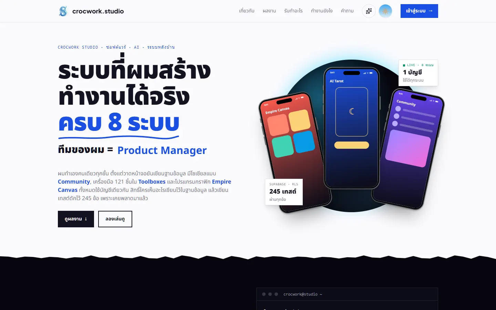
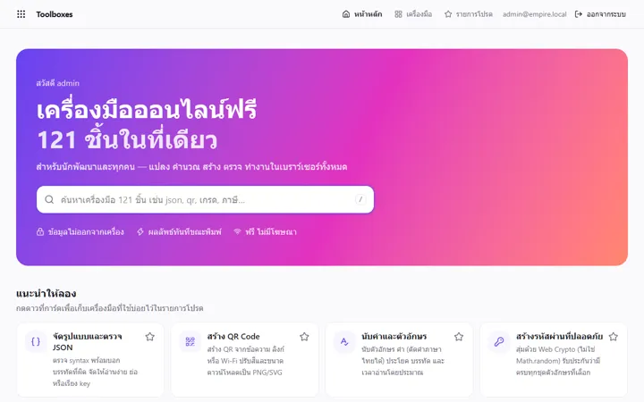
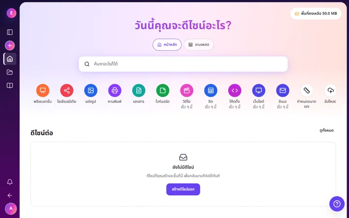
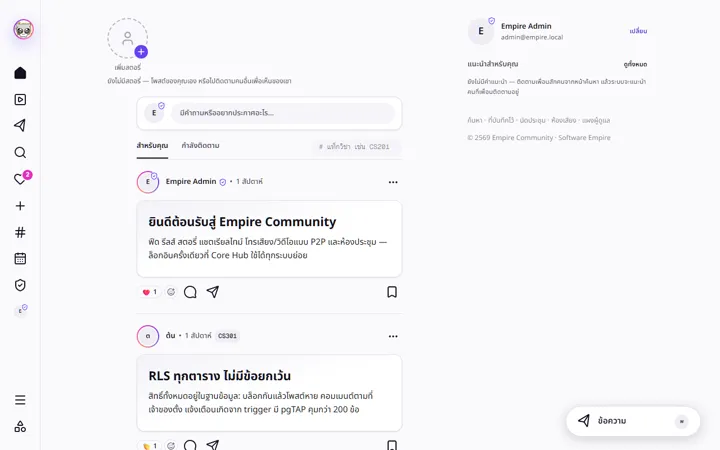

<p align="center">
  
</p>

<h1 align="center">Software Empire</h1>

<p align="center">
  <em>One hub, many apps, zero infrastructure bill.</em>
</p>

<p align="center">
  <a href="https://github.com/CROC101/software-empire/actions/workflows/ci.yml"></a>
  <a href="https://github.com/CROC101/software-empire/actions/workflows/deploy.yml"></a>
  <a href="https://github.com/CROC101/software-empire/actions/workflows/codeql.yml"></a>
  <a href="https://scorecard.dev/viewer/?uri=github.com/CROC101/software-empire"></a>
  
  <a href="LICENSE"></a>
</p>

<p align="center">
  <a href="https://crocwork-hub.crocwork.workers.dev"><strong>Live site</strong></a> &middot;
  <a href="docs/MASTER-SPEC.md">Spec</a> &middot;
  <a href="docs/DEPLOY.md">Deploy</a> &middot;
  <a href="CONTRIBUTING.md">Contributing</a>
</p>

<p align="center">
  
</p>

---

An enterprise-style portfolio by one developer: a Core Hub with single sign-on, plus client-side-first apps, all in one pnpm + Turborepo monorepo. Everything runs on free tiers: Cloudflare Workers for hosting, Supabase for data and auth.

## Apps

| App                           | Stack              | What it is                                   |
| ----------------------------- | ------------------ | -------------------------------------------- |
| [`hub`](apps/hub)             | Next.js 16         | Portfolio, login, `/admin` CMS for every app |
| [`community`](apps/community) | Vite SPA           | Chat, feed, reels, meetings                  |
| [`commerce`](apps/commerce)   | Next.js 16         | Freelance market with PromptPay              |
| [`toolboxes`](apps/toolboxes) | Vite SPA           | 121 browser tools                            |
| [`canva`](apps/canva)         | Vite SPA           | Graphics editor                              |
| [`crocbyte`](apps/crocbyte)   | Next.js + Firebase | Client-work site                             |

<p align="center">
  
  
  
</p>

Shared code lives in [`packages/ui`](packages/ui) (Tailwind v4, design tokens, components), [`packages/core`](packages/core) and [`packages/config`](packages/config) (ESLint, tsconfig).

## How it is built

- **Data:** Supabase Postgres, one schema per app, Row Level Security on every table, 268 pgTAP tests.
- **Auth:** one session cookie shared across apps. No tokens in `localStorage`.
- **Hosting:** every app is a Cloudflare Worker. Each PR gets a preview; `main` deploys.
- **Safety:** CodeQL, OpenSSF Scorecard, Dependabot, dependency review, actions pinned by SHA, strict security headers.
- **Ops:** nightly encrypted database backup, daily keep-alive for the free Supabase tier.

Architecture decisions (ADRs) are in [`docs/MASTER-SPEC.md`](docs/MASTER-SPEC.md).

## Develop

Requires Node 24 and pnpm 12.

```sh
pnpm install
pnpm dev           # all apps
pnpm verify        # lint + typecheck + test + build
pnpm format:check
```

| Path         | Purpose                        |
| ------------ | ------------------------------ |
| `apps/*`     | Hub and apps                   |
| `packages/*` | Shared UI, core, config        |
| `supabase/`  | Migrations and pgTAP tests     |
| `standards/` | Repo rules and GitHub settings |
| `.github/`   | CI/CD, CODEOWNERS, templates   |

## Contributing

Read [CONTRIBUTING.md](CONTRIBUTING.md). Report security issues privately, see [SECURITY.md](SECURITY.md).

## License

[MIT](LICENSE) &copy; 2026 CROC101
